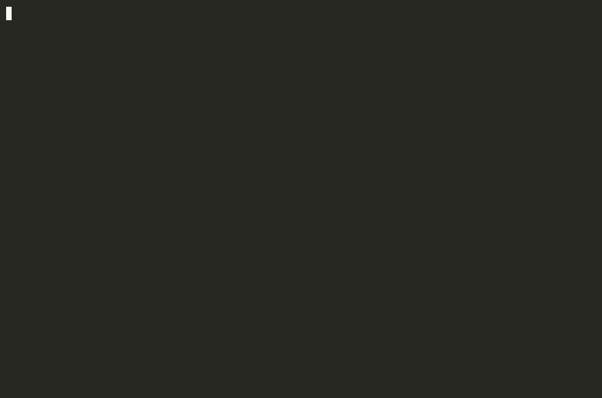
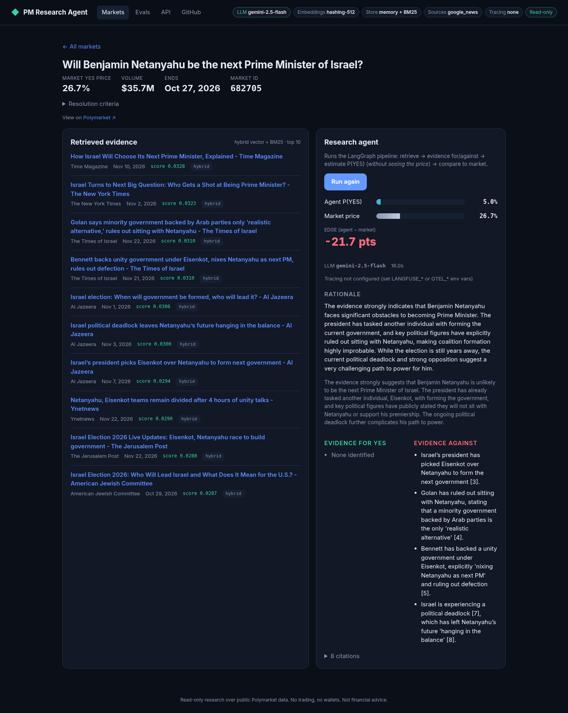
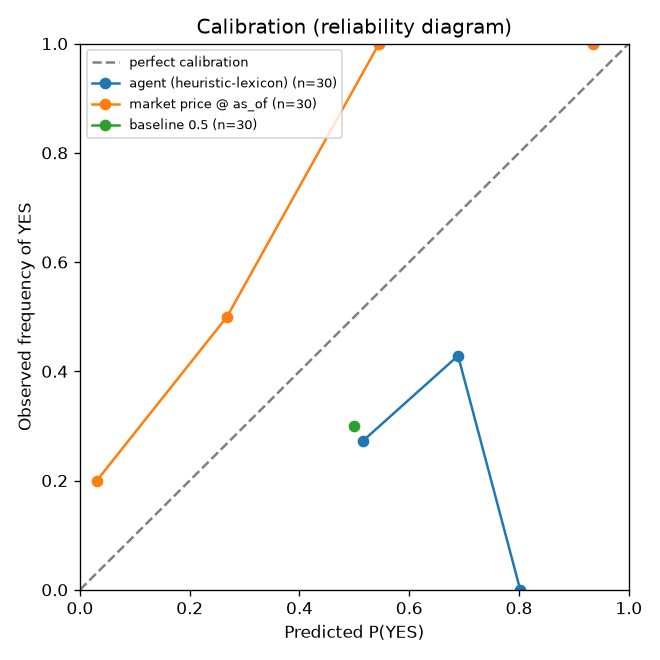
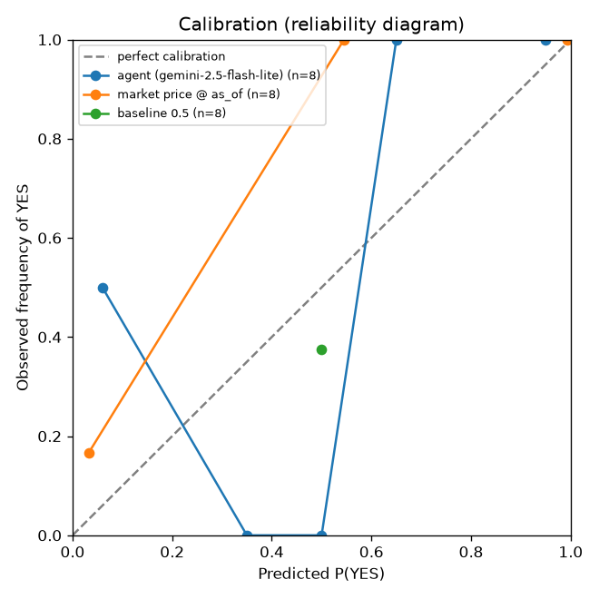
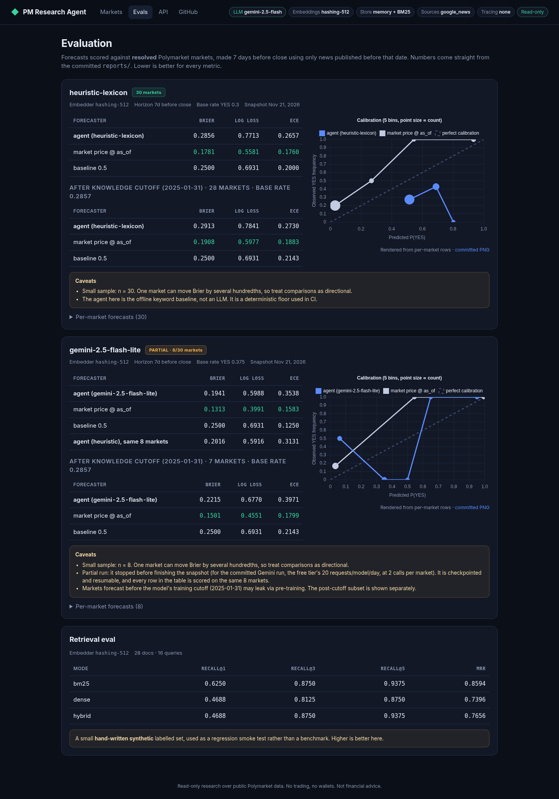

# Prediction-Market Research Agent

[](https://github.com/Anondevnet/polymarket-research-agent/actions/workflows/ci.yml)


An evidence-grounded research agent for [Polymarket](https://polymarket.com) prediction markets.
It ingests news into a vector store, runs a **LangGraph** agent that weighs evidence for and
against a market and estimates P(YES) *without seeing the price*, then compares that to the
market. Everything is exposed as a **FastAPI** service and an **MCP server**. Forecasts are
**back-tested against resolved markets** with Brier score, log loss and calibration, and every
step is **traced** (Langfuse / LangSmith / OpenTelemetry).





> **Read-only by design.** The project only reads public market data and news. It contains
> no wallet, signing, or order-placement code.

---

## Skills demonstrated

| Skill | Where to look |
|---|---|
| **Retrieval with vector search** | Pluggable sources ([`sources/`](src/pm_research/sources)) for Google News RSS and GDELT, sentence-aware chunking ([`chunking.py`](src/pm_research/chunking.py)), configurable embeddings: offline hashing, local sentence-transformers, or OpenAI ([`embeddings.py`](src/pm_research/embeddings.py)). **Qdrant** (server, on-disk, or `:memory:`) plus a numpy fallback ([`vectorstore.py`](src/pm_research/vectorstore.py)), and **hybrid retrieval**: dense + BM25 with reciprocal-rank fusion ([`retrieval.py`](src/pm_research/retrieval.py)). |
| **LLM evaluation & tracing** | A forecast eval against resolved Polymarket markets: Brier, log loss, ECE, and a reliability diagram ([`evals/forecast_eval.py`](src/pm_research/evals/forecast_eval.py)). A retrieval eval reporting recall@k and MRR for BM25, dense, and hybrid ([`evals/retrieval_eval.py`](src/pm_research/evals/retrieval_eval.py)). Langfuse + OpenTelemetry spans that do nothing until configured ([`tracing.py`](src/pm_research/tracing.py)), LangSmith via env, and CI that gates on an eval threshold. |
| **Agent frameworks & MCP** | A LangGraph `StateGraph`: gather → retrieve → summarize evidence → estimate probability → compare to market ([`agent/graph.py`](src/pm_research/agent/graph.py)). An MCP server built on the official SDK with `list_markets`, `search_evidence`, and `research_market` tools ([`mcp_server.py`](src/pm_research/mcp_server.py), [docs](docs/mcp.md)). |
| **Cloud deployment** | FastAPI service ([`api.py`](src/pm_research/api.py)) with a built-in [web dashboard](#dashboard), a multi-stage non-root [`Dockerfile`](Dockerfile), [`docker-compose.yml`](docker-compose.yml) (API + Qdrant + MCP), and **Google Cloud Run** via [Terraform](deploy/cloudrun/terraform) (Artifact Registry, Secret Manager, a least-privilege service account, private-by-default IAM), a [`deploy.sh`](deploy/cloudrun/deploy.sh), and a [GitHub Actions deploy workflow](.github/workflows/deploy-cloudrun.yml) using Workload Identity Federation. |

---

## Architecture

```mermaid
flowchart LR
    subgraph Sources["Evidence sources (pluggable)"]
        GN[Google News RSS]
        GD[GDELT DOC API]
        ST[Static / JSONL]
    end
    subgraph PM["Polymarket (read-only)"]
        GA[Gamma API<br/>markets + resolutions]
        CL[CLOB API<br/>price history]
    end

    Sources -->|as_of cutoff| ING[Chunk + embed]
    ING --> VS[(Qdrant / in-memory<br/>vectors + payload)]
    ING --> BM[BM25 index]

    subgraph Agent["LangGraph agent"]
        direction TB
        G1[gather] --> G2[retrieve<br/>hybrid RRF] --> G3[summarize evidence<br/>for / against] --> G4[estimate P&#40;YES&#41;<br/>price hidden] --> G5[compare to market<br/>edge]
    end
    VS --> G2
    BM --> G2
    GA --> Agent
    CL --> G5

    Agent --> API[FastAPI<br/>/markets /evidence /research]
    Agent --> MCP[MCP server<br/>stdio + streamable HTTP]
    API --> CR[(Cloud Run)]

    subgraph Eval["Eval harness"]
        SN[snapshot: resolved markets<br/>+ pre-cutoff news + price@as_of] --> FE[Brier / log loss / ECE<br/>calibration plot]
        RE[labelled set] --> RR[recall@k / MRR]
    end
    GA --> SN
    CL --> SN
    Agent --> FE

    Agent -. spans .-> TR[Langfuse / LangSmith / OTel]
```

**Look-ahead guard.** When back-testing, evidence must be published strictly before the
forecast time `as_of = min(endDate, closedTime) − horizon`. This is enforced three times: in
the source query (`before:` / `enddatetime`), when parsing (undated items are dropped), and at
retrieval time in the graph. A test checks that the committed snapshot respects it.

**Independent estimate.** The `estimate_probability` node never sees the market price, so the
agent's number can be scored against the market rather than copying it. The final node
computes `edge = p_agent − p_market`.

---

## Quickstart

```bash
git clone https://github.com/Anondevnet/polymarket-research-agent && cd polymarket-research-agent
python -m venv .venv && source .venv/bin/activate
pip install -e ".[dev,all]"
cp .env.example .env          # works as-is offline; add OPENAI_API_KEY for a real LLM

pytest                        # all offline, network mocked
pmra markets --limit 10       # live Polymarket markets
pmra research <market_id>     # run the agent on one market
pmra serve                    # http://localhost:8080/docs  (MCP at /mcp/)
pmra mcp                      # MCP over stdio for Claude Desktop / Cursor
```

With Docker (API + persistent Qdrant + standalone MCP):

```bash
docker compose up --build     # API :8080, Qdrant :6333, MCP :8765/mcp
```

### Configuration

All settings are environment variables (see [`.env.example`](.env.example)):

| Variable | Default | Options |
|---|---|---|
| `PMRA_LLM_PROVIDER` | `heuristic` | `openai`: any OpenAI-compatible endpoint via `OPENAI_BASE_URL` (Ollama, vLLM, xAI…). `gemini`: preset for Gemini's OpenAI-compatible endpoint, using `GEMINI_API_KEY` |
| `PMRA_LLM_MIN_INTERVAL_S` / `PMRA_LLM_MAX_RETRIES` | `0` / `6` | pacing between calls, and backoff retries on 429/5xx (honours `Retry-After`; daily-quota errors fail fast) |
| `PMRA_EMBEDDING_PROVIDER` | `hashing` | `sentence-transformers` (`pip install .[local]`), `openai` |
| `PMRA_VECTOR_STORE` | `qdrant` | `memory` |
| `PMRA_QDRANT_URL` | `:memory:` | local path, or `http://qdrant:6333` / Qdrant Cloud |
| `PMRA_HYBRID` | `true` | dense + BM25 RRF fusion |
| `PMRA_SOURCES` | `google_news,gdelt` | add your own with `@register_source("name")` |
| `LANGFUSE_PUBLIC_KEY` / `LANGFUSE_SECRET_KEY` | unset | enables Langfuse traces |
| `LANGSMITH_TRACING` / `LANGSMITH_API_KEY` | unset | enables LangSmith traces of the graph |
| `OTEL_EXPORTER_OTLP_ENDPOINT` / `PMRA_OTEL_CONSOLE` | unset | any OTel backend, or print spans to the console |

The defaults (`heuristic` LLM and `hashing` embeddings) need no keys and are deterministic, so
CI and tests run offline. They are baselines, not the intended production setup.

---

## Evaluation

### How it works

```bash
# 1) Snapshot (network): resolved markets from Gamma, YES price at as_of from the CLOB,
#    and news published before as_of. Saved so evals are reproducible offline.
pmra eval snapshot --n 30 --horizon 7 --end-date-min 2025-01-01 --end-date-max 2026-11-01

# 2) Score (offline): agent vs market price vs 50% baseline. Writes reports/forecast_eval.{json,md}
#    and reports/calibration.png
pmra eval forecast

# 3) Retrieval: recall@k / MRR for bm25 vs dense vs hybrid on the labelled set
pmra eval retrieval --min-hybrid-recall5 0.8
```

CI runs steps 2 and 3 on every push against the committed snapshot. It fails if hybrid
recall@5 drops below the threshold and posts the forecast table to the job summary.

### Results (actually run, 2026-11-21)

**CI unit tests.** In [GitHub Actions](https://github.com/Anondevnet/polymarket-research-agent/actions/runs/45044177813) on 22 November 2026, the offline mocked-network suite was **59 passed** on Python 3.11 and **59 passed** on Python 3.12. The same workflow ran the offline retrieval eval (hybrid recall@5 gate 0.8) and the heuristic forecast eval on the committed snapshot.


**Dataset.** 30 resolved Polymarket binary markets: the highest-volume ones with an end date
between 2025-01-01 and 2026-11-01 that had a clean 0/1 resolution and price history at
`as_of`. Forecasts are made 7 days before close. Evidence is 315 Google News headlines, all
published before their cutoff. The base rate of YES is 0.30. Embeddings are offline
(`hashing-512`) in every run.

**Full run: all 30 markets, keyword baseline** ([`reports/heuristic/`](reports/heuristic))

| Forecaster | Brier ↓ | Log loss ↓ | ECE ↓ |
|---|---|---|---|
| agent: keyword baseline (`heuristic-lexicon`) | 0.2856 | 0.7713 | 0.2657 |
| market price 7 days before close | 0.1781 | 0.5581 | 0.1760 |
| baseline 0.5 | 0.2500 | 0.6931 | 0.2000 |

**LLM run: Gemini 2.5 Flash-Lite. ⚠️ PARTIAL: 8 of 30 markets**
([`reports/gemini-2.5-flash-lite/`](reports/gemini-2.5-flash-lite))

Run on 2026-11-21 through Gemini's OpenAI-compatible endpoint
(`PMRA_LLM_PROVIDER=gemini`, `gemini-2.5-flash-lite`, temperature 0). It stopped after 8
markets because the **free tier allows 20 requests per model per day**, and the agent makes
two calls per market. The run is checkpointed in `rows.jsonl`, so re-running the same command
after the daily reset picks up where it stopped. All rows below are scored on **the same 8
markets** (base rate YES 0.375):

| Forecaster | Brier ↓ | Log loss ↓ | ECE ↓ |
|---|---|---|---|
| agent: LLM (`gemini-2.5-flash-lite`) | 0.1941 | 0.5988 | 0.3538 |
| agent: keyword baseline, same 8 markets | 0.2016 | 0.5916 | 0.3131 |
| market price 7 days before close | 0.1313 | 0.3991 | 0.1583 |
| baseline 0.5 | 0.2500 | 0.6931 | 0.1250 |

Excluding the one market forecast before the model's training cutoff (January 2025): 7
markets, base rate 0.29. LLM Brier 0.2215 / log loss 0.677 / ECE 0.397. Market Brier 0.1501
/ 0.4551 / 0.1799. Keyword baseline 0.2209 / 0.6333 / 0.3207. Baseline 0.5: 0.25 / 0.6931 /
0.2143.

How to read this:
- **Too small to conclude anything.** With n=8, a single market moves the Brier score by
  several hundredths. On these markets the LLM beat the 50% guess on Brier and log loss, was
  roughly tied with the keyword baseline (and worse on log loss once the pre-cutoff market is
  dropped), and stayed clearly behind the market price. Its calibration error is high because it rarely
  went below 0.35 on long shots that resolved NO.
- **Training-data leakage.** A model can "remember" outcomes from before its training
  cutoff. Gemini 2.5's cutoff is January 2025, so `--knowledge-cutoff 2025-01-31` reports the
  post-cutoff subset separately. Newer Gemini models were deliberately not used, because
  they have probably seen most of these outcomes.
- An earlier attempt with `gemini-2.5-flash` hit the same 20-requests-per-day cap after about
  11 markets. That was before checkpointing existed, so none of its rows were kept, and it is
  not reported.
- The keyword-baseline row for the same 8 markets was computed from
  `reports/heuristic/rows.jsonl`. The difference from its 30-market score (0.2856) shows how
  much the sample matters.

Reproduce or finish the run (free key from [AI Studio](https://aistudio.google.com/apikey)):

```bash
export GEMINI_API_KEY=...            # never commit it
PMRA_LLM_PROVIDER=gemini PMRA_LLM_MODEL=gemini-2.5-flash-lite PMRA_LLM_MIN_INTERVAL_S=6.5 \
  pmra eval forecast --out reports/gemini-2.5-flash-lite --knowledge-cutoff 2025-01-31
# score what's checkpointed so far without calling the API:
pmra eval forecast --out reports/gemini-2.5-flash-lite --knowledge-cutoff 2025-01-31 --partial
```

 

**Retrieval eval.** A small *hand-written synthetic* labelled set: 28 docs and 16 queries
([`data/eval/`](data/eval)). It is a regression smoke test, not a benchmark. Embedder: `hashing-512`.

| Mode | recall@1 | recall@3 | recall@5 | MRR |
|---|---|---|---|---|
| BM25 | 0.625 | 0.875 | 0.9375 | 0.859 |
| dense (hashing) | 0.469 | 0.813 | 0.875 | 0.740 |
| hybrid (RRF) | 0.469 | 0.875 | 0.9375 | 0.766 |

(recall@1 can't reach 1.0 when a query has two relevant docs.) With lexical hashing
embeddings, dense search can't beat BM25. Switching to `PMRA_EMBEDDING_PROVIDER=sentence-transformers`
or `openai` is the obvious next measurement.

---

## Dashboard

A small web dashboard ships with the API. It's plain HTML, CSS, and vanilla JS served by
FastAPI, with Chart.js from a CDN, so there's no build step.

```bash
make dashboard                 # or: PMRA_SOURCES=google_news pmra serve --port 8000
open http://localhost:8000/dashboard
# with a real LLM (free key from AI Studio; never commit it):
GEMINI_API_KEY=... PMRA_LLM_PROVIDER=gemini PMRA_LLM_MODEL=gemini-2.5-flash make dashboard
```

| View | What it shows |
|---|---|
| **Markets** | Active high-volume binary markets from the Gamma API, with YES price, volume, and end date, plus a filter |
| **Market detail** | Hybrid-retrieved evidence (source, date, fusion score) and a **Run research** button: agent P(YES) vs market price, the edge, rationale, evidence for and against, citations, and a trace link when Langfuse or `PMRA_TRACE_URL_TEMPLATE` is set |
| **Evals** | The committed `reports/` runs: metric tables, a post-knowledge-cutoff subset, same-sample comparisons, calibration charts drawn from per-market rows, caveats, and the retrieval eval |

The header shows the active configuration (LLM, embeddings, store, sources, tracing). The
default offline keyword baseline is labelled as such wherever it shows up.

 

<sub>Left: a live research run with `gemini-2.5-flash` on 2026-11-22 (Netanyahu market:
agent 5.0% vs market 26.7%). Right: the eval page, rendered from the committed reports.
Markets list: [`docs/img/dashboard-markets.png`](docs/img/dashboard-markets.png).
Regenerate with `make screenshots`.</sub>

## API

| Method | Path | Description |
|---|---|---|
| GET | `/dashboard` | Web dashboard (`/` redirects here) |
| GET | `/healthz` | Liveness |
| GET | `/markets/{id}` | One market |
| GET | `/api/evals` · `/api/config` | Eval reports and active config, used by the dashboard |
| GET | `/markets?limit=` | Top active binary markets |
| GET | `/markets/{id}/evidence?q=&k=` | Retrieved evidence (ingests lazily on first call) |
| POST | `/markets/{id}/research` | `{"as_of": "2025-09-01T00:00:00Z"}` (optional) → forecast |
| * | `/mcp/` | MCP streamable-HTTP endpoint |

## Deploy to Google Cloud Run

```bash
# Option A: one script (Cloud Build → Artifact Registry → Cloud Run, private by default)
PROJECT_ID=my-proj REGION=us-central1 ./deploy/cloudrun/deploy.sh

# Option B: Terraform
cd deploy/cloudrun/terraform && cp terraform.tfvars.example terraform.tfvars
terraform init && terraform apply
printf '%s' "$OPENAI_API_KEY" | gcloud secrets versions add openai-api-key --data-file=-
```

For persistent vectors across instances, point `PMRA_QDRANT_URL` at Qdrant Cloud. With
`:memory:`, each instance re-ingests on first request.

## Project layout

```
src/pm_research/
  config.py            settings (env / .env)
  models.py            Market, Document, Chunk, Forecast ...
  polymarket.py        Gamma + CLOB read-only client
  sources/             google_news, gdelt, static  (+ registry)
  chunking.py          sentence-aware sliding window
  embeddings.py        hashing | sentence-transformers | openai
  vectorstore.py       Qdrant | in-memory
  retrieval.py         dense, BM25, RRF hybrid
  llm.py, prompts.py   OpenAI-compatible chat LLM | heuristic baseline
  agent/graph.py       LangGraph state machine
  service.py           composition root used by API, MCP, CLI, evals
  api.py               FastAPI (+ mounts MCP and the dashboard)
  dashboard.py, web/   dashboard routes + static SPA (HTML/CSS/JS, Chart.js via CDN)
  mcp_server.py        MCP tools
  tracing.py           Langfuse / OTel spans (no-op by default)
  evals/               metrics, forecast eval, retrieval eval, calibration plot
  cli.py               `pmra` entry point
tests/                 offline tests (respx-mocked HTTP, fake LLM client)
data/eval/             labelled retrieval set + resolved-market snapshot
deploy/cloudrun/       deploy.sh + Terraform
```

## Limitations and next steps

- Google News RSS gives headlines plus outlet only. Fetching full article text would give
  the LLM much more to work with. The feed's terms allow personal, non-commercial use.
- GDELT rate-limits heavily, so it degrades gracefully and the snapshot is mostly Google News.
- The resolved-market sample is skewed toward long-shot multi-outcome legs (World Cup winner,
  NBA champion), because it is ranked by volume. Stratifying by price at `as_of` would make a
  harder test.
- Next: score an LLM-backed run, add a reranker, and stream intermediate graph state over SSE.

## License

MIT
